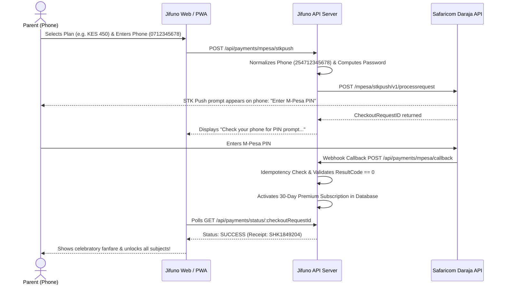

# Jifuno CBE Monetization Architecture & Financial Cost Model

This document outlines the self-sustaining monetization strategy, pricing model, Safaricom Daraja M-Pesa integration, unit economics, and break-even thresholds for Jifuno across Kenyan primary school learners (Grades 3–6).

---

## 1. Value Proposition & Freemium Model

Jifuno operates a child-centric, parent-funded freemium model aligned with the Kenya Competency-Based Curriculum (CBC):

### Free Tier (Accessible to All Kenyan Learners)
- **Daily Cap**: Up to **3 free lessons per day**.
- **Subject Access**: Foundational **Mathematics** and **English Language Activities**.
- **Gamification**: Hearts, XP, streaks, and basic level progression.
- **Device Support**: Optimized for low-end shared Android smartphones (offline PWA caching).

### Parent-Paid Premium Tier (Unlocks Full Potential)
- **Unlimited Daily Lessons**: No restrictions or waiting periods.
- **Complete CBC Curriculum Access**: All 8,700+ questions across Mathematics, English, Kiswahili, Science & Technology, Agriculture, and Creative Arts.
- **Unlimited Hearts Refill**: Immediate recovery so learners never get discouraged.
- **AI Socratic Tutor**: Context-rich hints with Kenyan cultural narratives (Nakuru farms, Karatina markets, Eldoret athletic relays).
- **Parent WhatsApp & SMS Mastery Reports**: Weekly progress, competency radar, and actionable home-coaching tips.

---

## 2. Subscription Pricing (in Kenyan Shillings - KES)

| Plan | Price (KES) | Equivalent (USD) | Duration | Ideal For |
|---|---|---|---|---|
| **Weekly Sprint** | **KES 150** | ~$1.15 | 7 days | Exam prep & end-of-term revision sprints |
| **Monthly Champion** *(Most Popular)* | **KES 450** | ~$3.46 (~KES 15/day) | 30 days | Continuous CBE competency mastery |
| **Termly Scholar** *(Best Value)* | **KES 1,200** | ~$9.23 | 90 days (1 term) | Full school term coverage (saves KES 150) |
| **Family Bundle** | **KES 750** | ~$5.77 | 30 days | Up to 3 siblings under one parent account |

### Grace Period & Expiration Policy
- **48-Hour Grace Period**: When a subscription expires, learners maintain full premium access for 48 hours to prevent learning disruption while the parent renews.
- **Soft Downgrade**: If not renewed after 48 hours, the account gracefully reverts to the Free Tier without deleting any learner streaks, XP, or badges.

---

## 3. Safaricom Daraja M-Pesa STK Push Architecture

Safaricom M-Pesa is the ubiquitous mobile money standard in Kenya (>98% mobile payment market share). Jifuno integrates Daraja M-Pesa Express (STK Push):

### Security & Operational Rules
1. **Never Trust the Client**: Subscription status is never unlocked via client-side state. Access is strictly determined by verified server-side transaction logs and webhook receipts.
2. **Idempotency**: Webhook callbacks verify `CheckoutRequestID` in an idempotency cache. Duplicate webhook deliveries by Safaricom never result in double crediting or conflicting date ranges.
3. **Phone Normalization**: Auto-formats `07...`, `01...`, `+254...`, and `254...` into the required `2547XXXXXXXX` format.

---

## 4. Financial Cost Model & Unit Economics

### Infrastructure & Operational Cost Breakdown (USD / Month)

| User Scale | Monthly Active Users (MAU) | Paying Subscribers (10% conv.) | Vercel Hosting | Supabase DB | M-Pesa Fees (~1.8%) | Reminders / SMS ($0.005) | Total Cost / Mo | Monthly Revenue (KES 450 / sub) | Net Profit / Mo |
|---|---|---|---|---|---|---|---|---|---|
| **Early Stage** | 100 | 10 | $0 (Hobby) | $0 (Free) | $0.62 | $2.00 | **$2.62** (~KES 340) | $34.60 (KES 4,500) | **+$31.98** (KES 4,160) |
| **Growth Stage** | 1,000 | 100 | $20 (Pro) | $25 (Pro) | $6.23 | $20.00 | **$71.23** (~KES 9,260) | $346.15 (KES 45,000) | **+$274.92** (KES 35,740) |
| **Scale Stage** | 10,000 | 1,000 | $40 (Pro+Edge) | $50 (Compute) | $62.30 | $100.00 | **$252.30** (~KES 32,800) | $3,461.50 (KES 450,000) | **+$3,209.20** (KES 417,200) |

---

## 5. Break-Even Analysis

Assuming an average Monthly Plan price of **KES 450 ($3.46 USD)**:

| Scenario | Total Monthly Operating Costs | Break-Even Paying Subscribers Required | Break-Even Conversion Rate |
|---|---|---|---|
| **100 Active Users** | KES 340 ($2.62) | **1 subscriber** | **1.0%** |
| **1,000 Active Users** | KES 9,260 ($71.23) | **21 subscribers** | **2.1%** |
| **10,000 Active Users** | KES 32,800 ($252.30) | **73 subscribers** | **0.73%** |

> [!TIP]
> At industry-standard edtech conversion rates (5% to 8%), Jifuno becomes cashflow-positive with fewer than **25 paying parents**, generating healthy surplus revenue to reinvest in curriculum depth, school licenses, and offline content distribution.

---

## 6. Growth Loops & Expansion

1. **Parent-to-Parent Referral Program**:
   - Each parent has a unique code (e.g. `AMINA254`).
   - When a friend signs up and subscribes, both families receive **+7 free days of Premium**.
2. **Viral WhatsApp Achievement Certificates**:
   - Parents can share one-click achievement cards on WhatsApp status and school parent groups.
3. **School & Teacher Class Licenses**:
   - Bulk annual subscriptions for schools at KES 3,000 / class / term.
